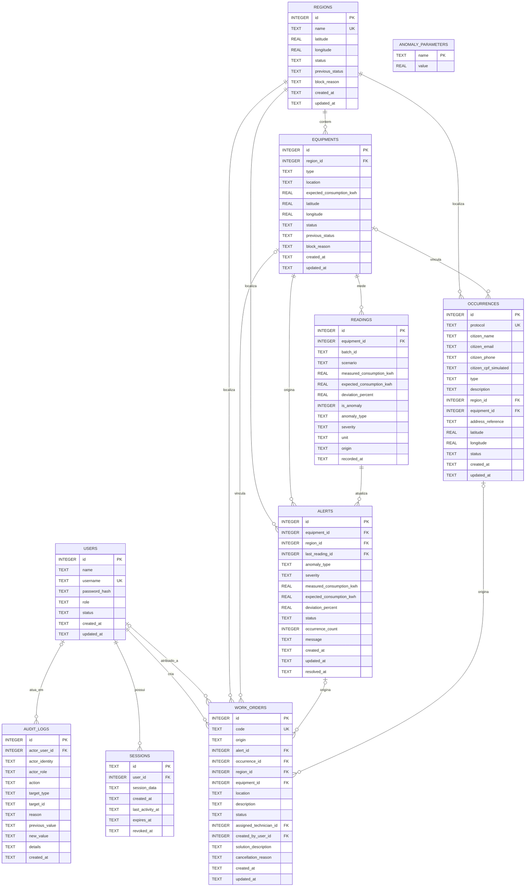

# Modelo de dados e diagrama ER — SGE-Urbano

## 1. Visão geral

O banco usa SQLite pelo módulo nativo `node:sqlite`. A conexão ativa
`PRAGMA foreign_keys = ON`. Migrações são ordenadas e transacionais; não existe
ORM.

As relações históricas usam `ON DELETE RESTRICT`. Alertas, ocorrências e ordens
de serviço possuem gatilhos que bloqueiam `DELETE` físico no funcionamento
normal.

## 2. Diagrama entidade-relacionamento

`anomaly_parameters` é uma tabela de configuração sem relacionamento por chave
estrangeira.

## 3. Restrições de integridade

### Referenciais

- `sessions.user_id → users.id`;
- `equipments.region_id → regions.id`;
- `readings.equipment_id → equipments.id`;
- `alerts.equipment_id → equipments.id`;
- `alerts.region_id → regions.id`;
- `alerts.last_reading_id → readings.id`;
- `occurrences.region_id → regions.id`;
- `occurrences.equipment_id → equipments.id`, opcional;
- `work_orders.alert_id → alerts.id`, opcional;
- `work_orders.occurrence_id → occurrences.id`, opcional;
- `work_orders.region_id → regions.id`;
- `work_orders.equipment_id → equipments.id`, opcional;
- `work_orders.assigned_technician_id → users.id`, opcional;
- `work_orders.created_by_user_id → users.id`;
- `audit_logs.actor_user_id → users.id`, opcional na migração 002.

Todas usam `ON DELETE RESTRICT`.

### Domínio

- usuário: `role` em `Gestor`/`Técnico`, `status` em `Ativo`/`Inativo`;
- região/equipamento: status `Ativo`, `Inativo` ou `Bloqueado`;
- leitura: cenário `normal`, `pico` ou `falha`;
- leitura: `origin = 'SIMULADO'` e `unit = 'kWh'`;
- alerta: status `Ativo`, `Suspenso` ou `Resolvido`;
- ocorrência e OS: `Aberta`, `Atribuída`, `Em atendimento`, `Concluída` ou
  `Cancelada`;
- alerta: severidade `Baixa`, `Média` ou `Alta`;
- ocorrência: os cinco tipos controlados da RN23;
- bloqueio: motivo com pelo menos 10 caracteres após `trim`;
- encerramento: OS `Concluída` exige solução;
- cancelamento: OS `Cancelada` exige justificativa.

## 4. Índices relevantes

- `idx_sessions_user_id`;
- `idx_sessions_expires_at`;
- `idx_equipments_region_id`;
- `idx_equipments_status`;
- `idx_readings_equipment_id`;
- `idx_readings_recorded_at`;
- `idx_alerts_active_equipment_type`, único e parcial para
  `Ativo`/`Suspenso`;
- `idx_alerts_filters`;
- `idx_occurrences_protocol`;
- `idx_occurrences_region_id`;
- `idx_work_orders_active_alert`, único e parcial para OS
  `Aberta`/`Atribuída`/`Em atendimento`;
- `idx_work_orders_status`;
- `idx_work_orders_technician`;
- `idx_audit_logs_action`;
- `idx_audit_logs_created_at`.

## 5. Preservação histórica e auditoria

Gatilhos bloqueiam:

- `UPDATE` e `DELETE` em `audit_logs`;
- `DELETE` em `alerts`;
- `DELETE` em `occurrences`;
- `DELETE` em `work_orders`.

Na migração 002, cada evento de auditoria possui exatamente uma identidade de
ator:

- `actor_user_id` para usuário autenticado; ou
- `actor_identity` para visitante/identidade pré-autenticação.

A limpeza da seed de teste remove registros dentro do fluxo exclusivo
`NODE_ENV=test`, usando a rotina controlada; essa superfície não altera as
garantias do ambiente normal.
